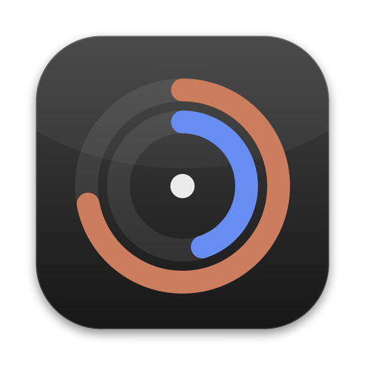
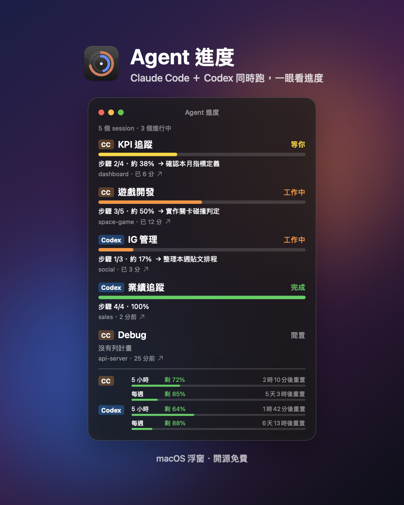
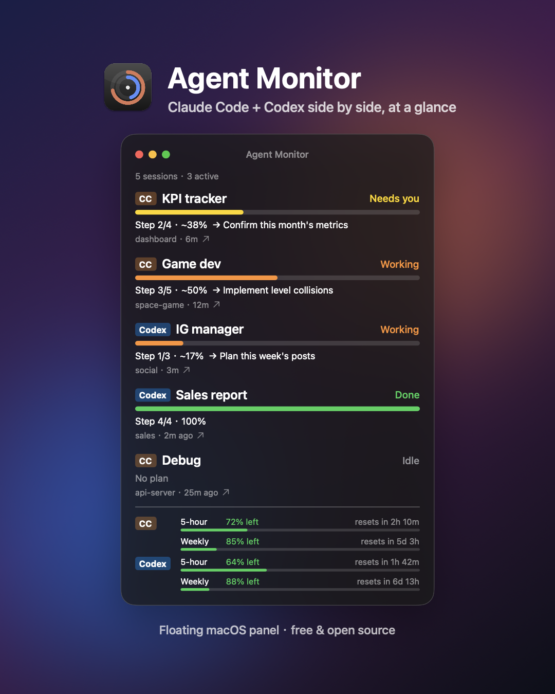

<p align="center">
  
</p>

<h1 align="center">Agent Monitor · Agent 進度</h1>

<p align="center">
  A floating macOS panel that shows every <b>Claude Code</b> and <b>Codex</b> session at a glance.<br>
  一個常駐桌面的 macOS 浮窗，同時盯住所有 <b>Claude Code</b> 和 <b>Codex</b> 的進度。
</p>

<p align="center">
  <a href="#繁體中文">繁體中文</a> · <a href="#english">English</a>
</p>

<p align="center">
  
  
</p>

<sub>Screenshots use demo data. 示意圖為示範資料。</sub>

---

## 繁體中文

同時開好幾個 Claude Code 對話串和 Codex 任務時，很難知道誰在跑、誰在等你、誰已經做完。Agent 進度把它們放進同一個浮窗：

- **同一個視窗看全部**：Claude Code 和 Codex 的 session 各佔一列，顯示標題、狀態、進度條和經過時間
- **四種狀態**：工作中／等你／完成／閒置，「等你」排最前面
- **估算進度**：讀 agent 自己列的計畫（Claude Code 的任務清單、Codex 的 `update_plan`），顯示「步驟 3/5 · 約 50%」；沒列計畫就只顯示轉圈，不亂給百分比；只有收到完成訊號才顯示 100%
- **點一下跳過去**：點任一列直接跳到那個 Claude Code 對話串或 Codex 對話
- **完成／等你提示**：系統通知加提示音，點通知也會跳轉；Claude Code 完成的聲音可單獨關掉
- **額度追蹤**：最下方顯示兩邊 5 小時與每週額度還剩多少、多久後重置（官方只公布百分比）
- **Liquid Glass 浮窗**：永遠在最上層、可拖曳、可縮成精簡模式；五段透明度，最淡跟 Dock 一樣清透
- **中英雙語**，開機自動啟動，全部可在選單列開關

### 需求

- macOS 14 以上（Liquid Glass 需要 macOS 26 以上，舊版自動改用模糊效果）
- Claude Code **桌面版**（點擊跳轉用的是桌面版連結）；Codex 為選用，支援 Codex 桌面版

### 安裝

**1. 浮窗 app**

從 [Releases](../../releases) 下載 `AgentMonitor.zip`，解壓後把 `AgentMonitor.app` 拖進「應用程式」。
這個 app 沒有經過 Apple 公證，第一次開啟請在 app 上按右鍵 › 打開，或在終端機執行：

```bash
xattr -dr com.apple.quarantine /Applications/AgentMonitor.app
```

也可以自己從原始碼建置（只需要 Xcode Command Line Tools）：

```bash
./scripts/install.sh
```

**2. Claude Code mod（Claude Code 那一側需要）**

Claude Code 的進度由一個 mod 寫出，在 Claude Code 裡執行：

```
/plugin marketplace add chunweimacwm/agent-progress-monitor
/plugin install agent-progress@agent-progress-monitor
```

裝好後新開的對話串就會被追蹤，側邊也會出現同樣內容的「Agent 進度」pane（`/progress` 可重開）。pane 語言可在 mod 設定改成 `en`。

**3. 讓 agent 列計畫（建議）**

進度條來自 agent 自己列的計畫。在你的 `CLAUDE.md`／`AGENTS.md` 加一句「超過 3 步的任務先用內建計畫工具列出步驟，並隨進度更新」，兩邊就會穩定出現進度條。

### 運作方式與隱私

- **只在本機**：不連網、不上傳任何資料
- Claude Code：mod 把每個對話串的狀態寫成 `~/.agent-progress/claude-code/<session>.json`，額度寫成 `~/.agent-progress/usage/claude-code.json`
- Codex：唯讀解析 `~/.codex/sessions/` 的紀錄與 `session_index.jsonl` 的標題；不讀 `auth.json` 或任何設定檔
- 舊的狀態檔沒有標題或跳轉 id 時，會從對話紀錄只取標題行、從 Claude 桌面版日誌取 session 對應
- 畫面只顯示標題、專案資料夾名稱與步驟名稱，不顯示對話內容

### 開發

```bash
./scripts/test.sh                 # 單元測試
swift run agentmon --watch        # 在終端機看狀態
./scripts/install.sh              # 建置並裝到 /Applications
```

---

## English

When several Claude Code threads and Codex tasks run at once, it's hard to tell which one is working, which one is waiting for you, and which one is done. Agent Monitor puts them all in one floating panel:

- **Everything in one window**: one row per Claude Code or Codex session with title, status, progress bar and elapsed time
- **Four states**: Working / Needs you / Done / Idle, with "Needs you" on top
- **Estimated progress** from the plan the agent writes itself (Claude Code's task list, Codex's `update_plan`), shown as "Step 3/5 · ~50%". No plan means a spinner, not a made-up percentage; 100% only after a real completion signal
- **Click to jump** straight to that Claude Code thread or Codex conversation
- **Done / needs-you alerts**: system notification plus sound; clicking it jumps too. The Claude Code "done" sound can be turned off separately
- **Usage limits** at the bottom: 5-hour and weekly usage left for both tools, with reset countdowns (both vendors only publish percentages)
- **Liquid Glass panel**: always on top, draggable, compact mode, five transparency levels, the clearest one matching the Dock
- **English and Traditional Chinese**, launch at login, everything toggleable from the menu bar

### Requirements

- macOS 14 or later (Liquid Glass needs macOS 26+, older systems fall back to a blur)
- Claude Code **desktop app** (click-to-jump uses its deep links); Codex is optional and works with Codex Desktop

### Install

**1. The panel app**

Download `AgentMonitor.zip` from [Releases](../../releases), unzip, and drag `AgentMonitor.app` into Applications.
The app is not notarized by Apple. The first time, right-click it › Open, or run:

```bash
xattr -dr com.apple.quarantine /Applications/AgentMonitor.app
```

Or build from source (Xcode Command Line Tools are enough):

```bash
./scripts/install.sh
```

**2. The Claude Code mod (needed for the Claude Code side)**

Claude Code progress is written by a mod. Inside Claude Code run:

```
/plugin marketplace add chunweimacwm/agent-progress-monitor
/plugin install agent-progress@agent-progress-monitor
```

New threads are tracked from then on, and an "Agent Monitor" side pane shows the same list (`/progress` reopens it). Set the mod's `language` option to `en` for an English pane.

**3. Ask agents to write a plan (recommended)**

Progress bars come from the plan the agent writes. Add a line like "For tasks with more than 3 steps, list the steps with the built-in plan tool first and keep it updated" to your `CLAUDE.md` / `AGENTS.md`.

### How it works & privacy

- **Local only**: no network access, nothing is uploaded
- Claude Code: the mod writes each thread's state to `~/.agent-progress/claude-code/<session>.json` and usage to `~/.agent-progress/usage/claude-code.json`
- Codex: read-only parsing of `~/.codex/sessions/` logs and thread titles from `session_index.jsonl`; never reads `auth.json` or any config
- For older status files without a title or jump id, it reads only the title line from the transcript and the session mapping from the Claude desktop log
- Only titles, project folder names and step names are shown, never conversation content

### Development

```bash
./scripts/test.sh                 # unit tests
swift run agentmon --watch        # live status in the terminal
./scripts/install.sh              # build and install to /Applications
```

## License

MIT
